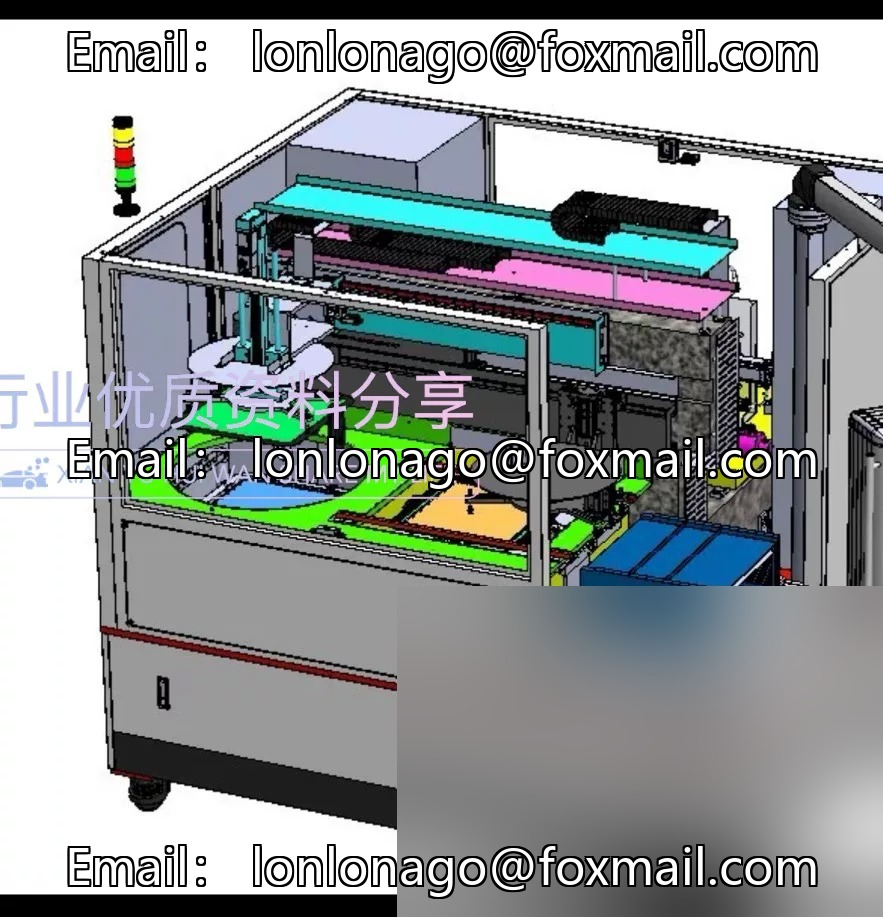
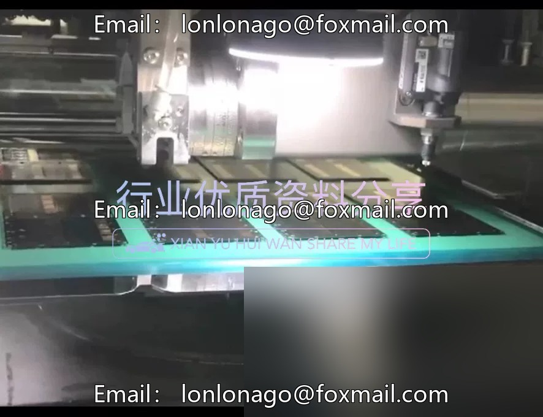
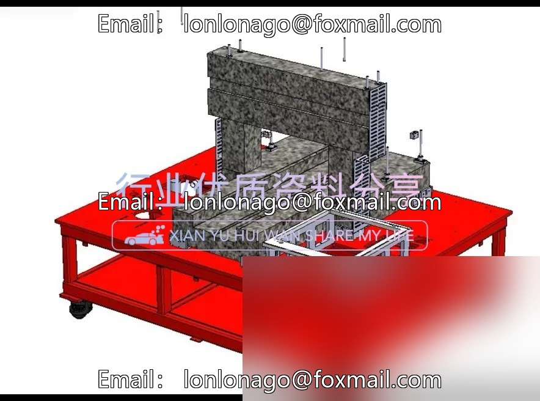
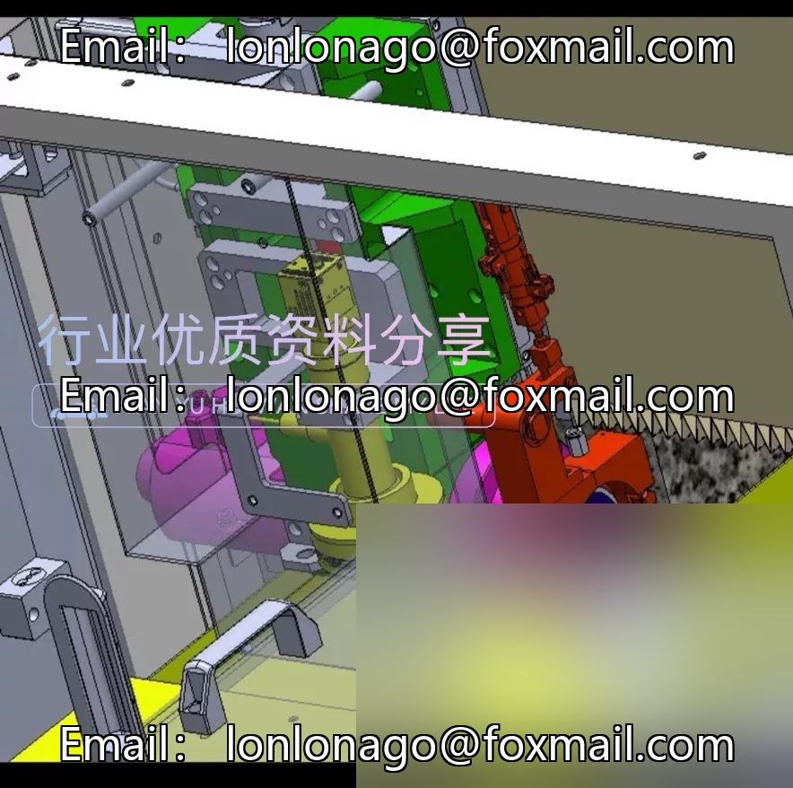
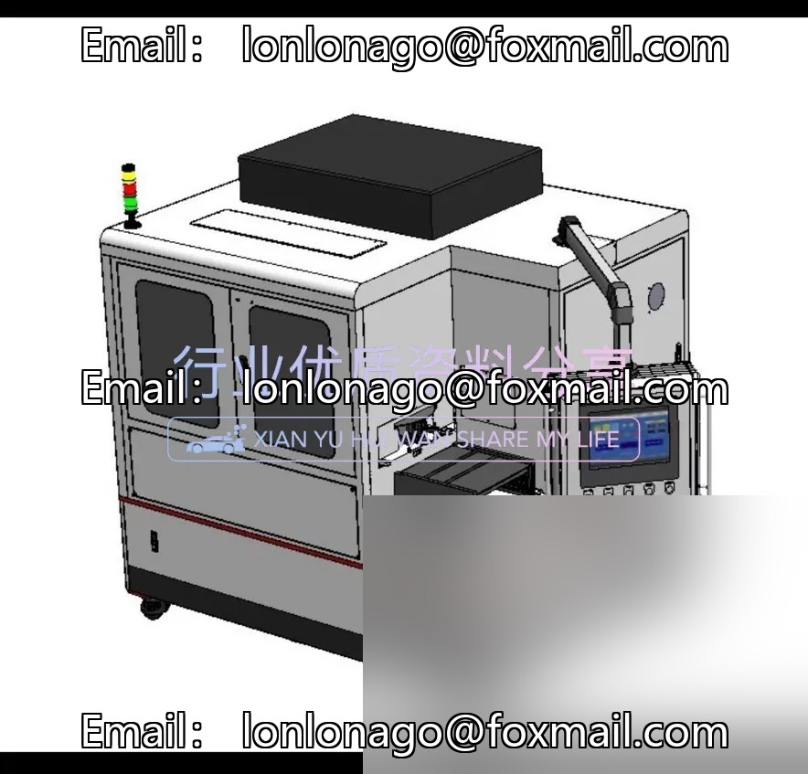

# Wafer cutting machine 3D drawing: (STP format), designed by Koreans, originating from Korean companies.

## Body

Wafer cutting machine 3D drawing: (STP format) Designed by Koreans, originating from a Korean company original drawing! Many design details! Using a high-rigid base and marble architecture, dual cutting heads for cutting, with drying function! Very valuable drawing! Can be purchased and get device operation video as gift!

Capture and send the electronic original directly! The following images include screenshots of the file portion. Please confirm before placing the order! Due to the replicable nature of electronic documentation Therefore, are allowed after purchase! Thanks for understanding!

For personal learning and reference use only.

The 3D drawing is in STP format, designed by a Korean person and sourced from a Korean company; it includes design details, a rigid base, marble architecture, dual cutting heads, a drying function, and other content.

<!-- AI_ENRICHED -->

## Images

## Payment

Here is a pay link on Stripe ( https://buy.stripe.com/3cs8yP7sY87d0vu9AB ). Please contact me lonlonago@foxmail.com after funding $89, and I will send you a complete data files , thank you!

